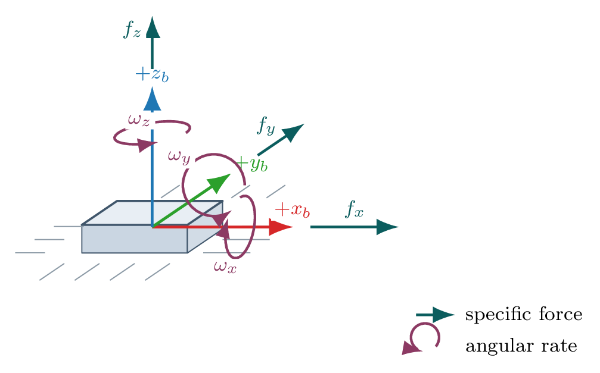

# Visual-Inertial Navigation Part A: IMU Dead Reckoning



## Overview

Part A focuses on inertial forward propagation. You will use the `drpy` and `acc` signals in the drone packets to build a 15-state flat-earth mechanization model and study how fast dead reckoning drifts away from truth.

This part is intentionally incomplete as a navigation system. That is the point. Before you can fuse measurements, you need to understand what the IMU-only solution does well, where it fails, and how its errors grow.

## Learning Outcomes

By the end of Part A, you should be able to:

- implement a 15-state inertial propagation model
- propagate the recorded IMU packets forward in time
- analyze drift from bias, gravity, integration error, and frame mistakes
- produce dead-reckoning diagnostics that will be reused in Part C

## Required State Convention

Use this state vector throughout the project:

``` python
x = [
    px, py, pz,
    roll, pitch, yaw,
    vx, vy, vz,
    bgx, bgy, bgz,
    bax, bay, baz,
]
```

Use:

``` python
R_world_body = Rz(yaw) @ Ry(pitch) @ Rx(roll)
gravity_world = np.array([0.0, 0.0, -9.81])
```

Angles must be wrapped into `[-pi, pi)` after propagation.

## Starter Interfaces

Work from the starter package:

``` python
from pathlib import Path

from drone_pipeline.datasets import load_drone_dataset
from drone_pipeline.mechanization import propagate_state
```

Your final implementation may add helpers, but the public propagation entrypoint should remain:

``` python
propagate_state(x, acc, drpy, dt, params)
```

## Goal

Implement deterministic inertial propagation using the packet IMU inputs.

Use the process model:

``` python
p_dot = v
rpy_dot = E(rpy) @ (drpy - gyro_bias)
v_dot = R_world_body(rpy) @ (acc - accel_bias) + gravity_world
gyro_bias_dot = 0
accel_bias_dot = 0
```

The deterministic propagation function may hold biases constant between samples. In Part C, the stochastic filters should model bias drift through process noise.

## Requirements

Implement:

``` python
propagate_state(x, acc, drpy, dt, params)
```

It must:

1.  accept the 15-state vector above
2.  subtract gyro and accelerometer biases
3.  convert body angular rates into Euler-angle rates
4.  rotate body acceleration into the world frame
5.  add gravity
6.  integrate position, attitude, velocity, and biases over `dt`
7.  wrap roll, pitch, and yaw after propagation

Forward Euler integration is acceptable for the base submission. If you choose a better integrator, keep the interface stable and explain the tradeoff.

## Initialization

For your reported dead-reckoning runs, initialize from the first valid visual pose estimate produced in Part B. Before Part B is finished, you may use a temporary oracle initialization for debugging, but you must label it clearly and you may not treat it as your primary reported result.

You may initialize velocity as:

- zero, or
- a finite-difference estimate derived from early visual poses

Be explicit about which choice you made.

## Evaluation

Use Vicon only for evaluation. Interpolate truth onto the packet timestamps.

Required analysis:

- position trajectory versus Vicon truth
- roll, pitch, and yaw versus Vicon truth
- position RMSE over time
- drift rate in meters per second or meters per minute
- short discussion of dominant error sources

At minimum, discuss:

- gyro bias
- accelerometer bias
- gravity handling
- frame convention mistakes
- integration error
- initialization sensitivity

## Deliverables

This is the first checkpoint of three that should go into the complete project. Ultimately you will turn in all deliverables across all three parts in one cohesive project.

For the checkpoint, you should have completed:

- `propagate_state(...)`
- a dead-reckoning trajectory for each dataset
- position and attitude comparison plots against Vicon truth
- position RMSE over time
- a short technical discussion of dominant error sources

## Notes

This part is supposed to drift. If your IMU-only trajectory looks suspiciously perfect, the first thing to check is whether truth leaked into the propagation path.