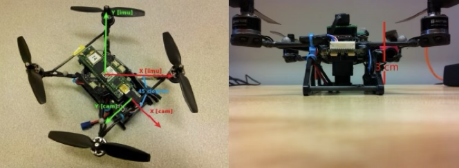
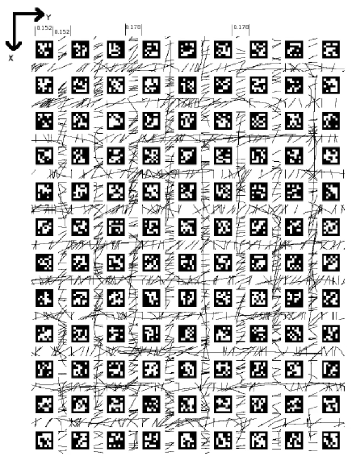

# Visual-Inertial Navigation Part B: AprilTag PnP Observation Model {#sec-project1b}

## Overview {#sec-project1b-overview}

Part B builds the visual observation model used by the filters in Part C. You will convert AprilTag corner detections into body pose estimates using the known tag-map geometry, supplied camera intrinsics, and OpenCV's `solvePnP`.

The hard part is not calling one library function. The hard part is building the correspondences, getting the frame conventions right, handling packets with missing tags, and estimating observation covariance honestly.

### Learning Outcomes

By the end of Part B, you should be able to:

- construct the AprilTag world-corner map
- recover pose from 2D-3D correspondences using `solvePnP`
- convert the camera pose into a body pose using the mounting transform
- estimate a usable visual measurement covariance from truth-referenced residuals

### Starter Interfaces

Use the starter package:

``` python
from pathlib import Path

from drone_pipeline.datasets import (
    interpolate_vicon_truth,
    load_drone_dataset,
    load_drone_parameters,
)
from drone_pipeline.observation import (
    build_apriltag_corner_map,
    estimate_measurement_covariance,
    estimate_pose,
)
```

## Visual Positioning {#sec-project1b-visual-positioning}

The primary object of this project checkpoint is to develop the visual observation model that the resulting navigation filtering algorithm will use to bound and correct the error growth in the dead reckoning state propagation method.

### Camera and Rig Parameters

The drone's camera is mounted on the body with a known rigid transform as shown below:



The camera intrinsics and mounting transform are provided in `data/drone-data/parameters.txt`. Use the starter package to load them:

``` python
params = load_drone_parameters()  # reads data/drone-data/parameters.txt
```

The key parameters are:

``` python
camera_matrix = params.camera_matrix
dist_coeffs = params.dist_coeffs
T_camera_body = params.T_camera_body
```

Do not invent a checkerboard calibration workflow. This dataset already gives you the intrinsics and mounting values.

### AprilTag Map

The tag mat is a `12 x 9` grid. The top-left corner of the top-left tag is world coordinate `(0, 0, 0)`. AprilTag ID numbers go from 0 to 107 incrementing along the x-axis first. We will relate the measurements provided in the information packets to this known map to derive a position fix.



Coordinate convention:

- `x` increases down the mat
- `y` increases to the right
- `z = 0` for all corners

Geometry:

``` python
tag_size = 0.152
normal_gap = 0.152
wide_gap = 0.178
```

Use `wide_gap` between columns `3-4` and `6-7`. Everywhere else use `normal_gap`.

Implement:

``` python
build_apriltag_corner_map() -> dict[int, np.ndarray]
```

Each value must be a `4 x 3` array of world-frame corners in the same order used by the packet detections:

1.  `p1`: bottom left
2.  `p2`: bottom right
3.  `p3`: top right
4.  `p4`: top left

### Pose Estimation

Implement:

``` python
estimate_pose(packet, camera_matrix, dist_coeffs, tag_map, T_camera_body)
```

It must:

1.  read `packet.id`, `packet.p1`, `packet.p2`, `packet.p3`, and `packet.p4`
2.  assemble matching `object_points` and `image_points`
3.  call `cv2.solvePnP`
4.  convert OpenCV's world-to-camera output into a body pose in the world frame
5.  return pose, reprojection error, and number of points used
6.  return `None` when there are too few usable correspondences

Required return shape:

``` python
{
    "t": packet_time,
    "position": np.ndarray,
    "rpy": np.ndarray,
    "reprojection_error": float,
    "num_points": int,
}
```

Use all four corners of every visible tag. Do not collapse tags to centroids. In this assignment, `T_camera_body` maps body-frame coordinates into the camera frame:

``` python
p_camera = T_camera_body @ p_body_homogeneous
```

`solvePnP` returns the transform from world coordinates to camera coordinates. If you call that:

``` python
T_camera_world
```

then a consistent baseline is:

``` python
T_world_camera = np.linalg.inv(T_camera_world)
T_world_body = T_world_camera @ T_camera_body
```

If you prefer a different internal convention, that is fine. Hide the convention change at the boundary, document it once, and keep it consistent.

### Covariance Estimation

Once we have developed a way to find the base measurement and related it to a global position, we must derive a way to calculate the certainty (or accuracy) of this measurement. You will implement:

``` python
estimate_measurement_covariance(observations, truth_samples)
```

Estimate a `6 x 6` covariance matrix from:

``` python
residual = z_pnp - z_truth
```

with:

``` python
z = [px, py, pz, roll, pitch, yaw]
```

which will give us a resulting measurement covariance matrix to be subsequently used in the filtering system. Note that angle residuals must be wrapped into `[-pi, pi)`.

Report:

- number of valid PnP packets per dataset
- median and 90th-percentile reprojection error
- estimated `R`
- any rounding, clipping, or inflation applied before filtering

## Deliverables {#sec-project1b-deliverables}

Submit:

- `build_apriltag_corner_map()`
- `estimate_pose(...)`
- `estimate_measurement_covariance(...)`
- position and attitude plots against Vicon truth
- a PnP RMSE table across all eight datasets
- the estimated measurement covariance `R`

## Notes {#sec-project1b-notes}

Most PnP failures in this project are not caused by `solvePnP`. They are caused by incorrect corner ordering, incorrect world geometry, or a silent frame-convention mistake that survives just long enough to look persuasive.